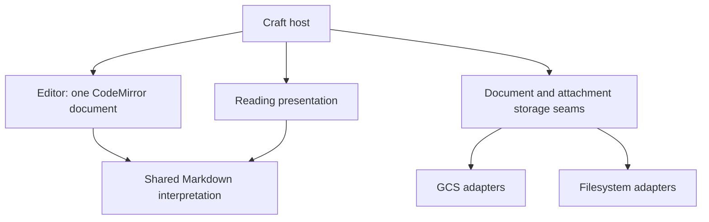

# Markdown editor architecture plan

Status: consolidated design for review. Planning only; application implementation
has not started. Confirmed product decisions and proposed engineering choices are
distinguished below.

## Confirmed product contract

- The complete Markdown file, including optional YAML frontmatter, is authoritative.
  Title, tags, and authored properties are derived from it. Do not persist parallel
  editable copies of those properties.
- Reuse existing document keys. Identity redesign and immutable-ID machinery are
  unnecessary for this iteration.
- Save is explicit through the Save control or Cmd/Ctrl+S. Autosave, durable
  browser recovery, background synchronization, and offline recovery are deferred.
- Invalid YAML or invalid configured embeds block Save with an actionable error
  pointing to the affected source. Retain all editable text. Ordinary unfinished
  Markdown, including an open code fence, is valid.
- Incomplete or malformed source never crashes the editor. Preview failures leave
  source available for editing. Parsing needed for preview remains incremental
  work during typing; Save performs the persistence validation.
- Last-save-wins behavior is sufficient for the single-editor use case. Do not
  build conflict detection, merge workflows, or concurrent editing features.
- Frontmatter has a compact readable summary. Clicking or keyboard navigation
  reveals YAML. Preserve unknown properties and comments. Property edits share
  the main undo history; a separate structured property-form editor is deferred.
- Live Preview reveals syntax locally as the caret enters formatted content.
  Live Preview and Source share the same source, selection, and undo history.
- Preserve rich code, list, table, media, and embed behavior. Language, title,
  copy, and useful controls stay discoverable. Widgets do not own separate
  editable copies of document text.
- Cover document writing: Live Preview, Source, reading, properties, keyboard
  behavior, links, code, lists, and attachments. Custom embeds remain available
  as host-supplied extensions.
- GCS and local filesystem adapters cover both Markdown and binary attachments.
  Local operation must not require GCS credentials. Cloudflare KV is a future
  motivating example, not an adapter to implement now.
- Obsidian guides interaction quality. Full vault interoperability, folder
  conventions, attachment-path migration, and complete Obsidian import/export
  compatibility are deferred. Preserve ordinary relative references and existing
  media links.
- LedgerClean, craft import, folders, tabs, backlinks, graphs, a plugin platform,
  and a new publishing workflow are outside this effort.

## Proposed engineering shape

### Persisted data

The document store maps a key to complete Markdown source. A loaded document needs
only its key and source. Properties, summaries, diagnostics, and render descriptions
are derived values, not additional persisted document models. Operational fields
may be stored separately only where current behavior requires them; do not invent
revision or timestamp systems for possible future features.

An attachment is separate binary content with the small amount of metadata needed
to serve it, such as filename and media type. Do not embed attachment blobs into
Markdown records or expose bucket paths in authored Markdown.

### Ownership

| Module | Owns | Does not own |
| --- | --- | --- |
| Markdown | Frontmatter reading and source edits, shared embed interpretation and validation, derived properties and diagnostics | Svelte, CodeMirror state, network calls, craft publication policy |
| Editor | CodeMirror source, selection, undo, preview decorations, commands and widget lifecycle | Storage providers, craft routes, tag allocation, a second editable text model |
| Save state | Captured source, last successful save, progress, failure and retry | Autosave, recovery queues, merge state |
| Storage adapters | Key-based document reads/writes/listing/deletion and separate attachment reads/writes | Frontmatter validation, rendering, tag colors, slug allocation |
| Craft host | Loading, composing editor and reader, explicit Save, craft validation, URL resolution, publication, tag presentation and extension configuration | Provider-specific persistence details or duplicate Markdown interpretation |

These are ownership responsibilities, not a requirement to introduce five new
packages. Keep save state in the existing session module if that retains useful
depth. Remove dead backup machinery; do not add a forwarding module to replace it.

### Shared interpretation, separate presentation

Keep CodeMirror's incremental syntax tree for source positions and editing.
Keep the existing Markdown AST tooling where it serves reading. Sharing meaning
and validation does not require replacing both parsers or creating a universal
persisted AST.

Concentrate duplicated embed prop decoding, nesting rules, and validation in the
Markdown module. Rendering and editing use that interpretation through their own
adapters. Pure embed interpretation must not import Svelte rendering definitions;
the editor must not reach into crafts to mount an embed.

Keep the existing feature lifecycle where it already provides locality:
source recognition, active selection rules, preview, and editing decorations.
Retain substantial code-header, list-command, and media behavior rather than
flattening every feature into one generic implementation.

### Host integration

- The host supplies link and attachment resolution. Shared Markdown code does
  not manufacture `/crafts/` URLs. Preserve current link behavior and correct
  local heading resolution without introducing a rename/backlink engine.
- Preserve existing `/media/` references as logical application paths. Resolve
  them through the selected attachment adapter. Ordinary relative references
  remain unchanged; host context determines their location.
- Pure document interpretation accepts absent frontmatter and arbitrary property
  names. Craft-specific property types and required fields belong to the host's
  Save validation, not the storage adapter or generic YAML reader.
- Generic properties can be displayed neutrally; craft colors and presentation
  are supplied by the host. Keep publication behavior behind craft integration.
- A single application composition point selects document and attachment adapters.
  Provider choice must not require edits throughout the editor or its features.
- Retain existing content keys, stored Markdown, and media references. No new
  draft/published snapshot model or content reformatting is needed.

### Explicit Save defaults

These are proposed engineering defaults for the agreed explicit-save behavior:

1. Capture current source and validate it with shared interpretation plus any
   host-specific requirements. Errors identify source locations and leave text intact.
2. Complete writes for newly referenced attachments, then write the captured
   Markdown. If required attachment persistence fails, report Save as failed.
3. Mark only the captured source as saved. Typing during Save remains possible;
   newer text stays unsaved. A repeated Save during an in-flight write must not
   launch parallel writes or silently discard the request to save newer text.
4. Preserve text after failure and allow explicit retry. Warn before abandoning
   unsaved changes. Do not claim browser recovery or durable success before the
   necessary writes complete.

Adapter implementations must not add conflict rejection to the agreed
last-save-wins workflow. This describes the application's single-editor behavior;
it does not promise global write ordering from every possible future KV provider.

## Build sequence, once implementation is authorized

1. Shape the Markdown model: key plus source; pure frontmatter handling and shared
   embed interpretation; move craft policy out while preserving stored content.
2. Deepen editor ownership: route property/widget edits through the same document,
   remove direct craft imports, keep code/list/media interaction behavior intact,
   and make malformed source safe throughout preview and reading.
3. Consolidate persistence: one document seam and one attachment seam, with GCS
   and filesystem adapters. Move shared craft policy out of adapter implementations;
   retain only caching/indexing that existing behavior needs.
4. Compose the craft host and explicit Save flow. Retire backup/conflict/Git
   terminology and unused machinery, update documentation, and verify real editing.

Each step preserves a runnable application and existing useful behavior. This is a
sequence of ownership changes, not permission for a broad rewrite.

## Verification criteria

- The same source produces consistent properties, embed acceptance, and errors
  in Save, editing preview, and reading presentation.
- Malformed YAML, partial tags, invalid configured props, and failed embed loads
  leave source editable. An open Markdown fence remains valid.
- Source/Live Preview switches preserve text, selection, and undo. Editing
  properties, code title/language, and task checkboxes is undoable in that history.
- Existing list behavior in `docs/editor-list-behavior.md` survives, including
  nesting, continuation lines, selected subtrees, and marker navigation.
- Browser checks cover caret movement, typing before/after block widgets, code
  highlighting/copy, tables, media, and desktop/mobile layout.
- GCS and filesystem document/attachment adapters run against the same behavioral
  contract cases. A local setup can edit, save, reload, and display attachments
  without GCS credentials.
- Save validation, upload/write failures, retry, repeated Save, and typing during
  a pending Save preserve the expected text and saved baseline.
- Switching storage leaves existing keys, Markdown, and logical media references
  usable. No silent normalization rewrites authored content on ordinary reads.

## Current implementation evidence

- `Page.ts` carries overlapping Markdown, frontmatter, properties, and summary
  fields with precedence rules.
- GCS and filesystem adapters duplicate parsing, indexing, caching, tag assignment,
  and save policy. The storage interface exposes craft-specific slug/tag concerns.
- The production session receives a no-op backup callback, while browser storage
  retains attachment blobs instead of document recovery.
- The YAML reader enforces craft property types; current saving requires a matching
  frontmatter ID. Wiki-link resolution hardcodes craft URLs.
- Attachment insertion directly accesses browser storage; server attachment
  reads/writes directly access GCS. Local document storage is not a complete
  local attachment setup today.
- Editor documentation still describes removed Git and browser recovery behavior.

## Reference behavior

- [Obsidian data storage](https://obsidian.md/help/data-storage)
- [Obsidian editing modes](https://obsidian.md/help/edit-and-read)
- [Cloudflare KV consistency](https://developers.cloudflare.com/kv/concepts/how-kv-works/)
