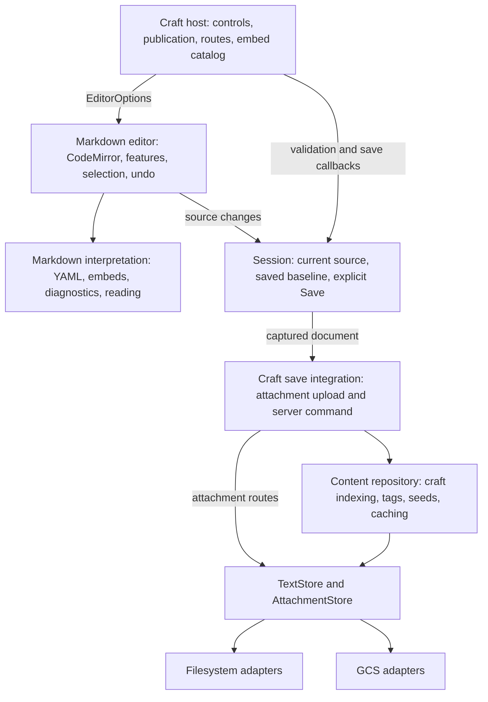

# Editor architecture

The persisted document is a key and its complete Markdown source, including
optional YAML frontmatter. The editor uses the same CodeMirror text in Live Preview
and Source mode; reading produces a separate presentation of that text.

Read this document for the system walkthrough, the
[editor module guide](../src/lib/editor/README.md) for code ownership, and the
[implementation plan](editor-architecture-plan.md) for the agreed product contract
and verification evidence.

## System map



Arrows show runtime collaboration. The generic editor imports neither the craft
host nor server storage. The host supplies the integration callbacks.

## The document model

The transported record is deliberately small:

```ts
type Document = {
	id: string;
	markdown: string;
};
```

For example, `id: "page_example"` points to this complete value:

```md
---
title: Architecture notes
slug: architecture-notes
tags: [engineering]
published: false
custom-property: preserved
---

# Architecture notes

The body is ordinary Markdown.
```

The metadata is inside the Markdown value. There is no separately persisted title,
tags, or publication flag to synchronize. Frontmatter is optional for the generic
editor; craft-specific property rules are supplied by the host.

`crafts/Page.ts` derives a disposable craft view from the source: title, slug, tags,
dates, and publication properties. Reads retain exact source, including malformed
host properties. Safe projections let that source remain accessible for correction;
Save validation reports invalid authored values. Existing document IDs are reused.

## Seams

- Markdown interpretation owns generic properties, embed meaning, and diagnostics.
  It does not know craft URLs, publication requirements, rendering implementations,
  or storage providers.
- Editor features own source positions, selection, decorations, keyboard behavior,
  and widget lifecycle. Host configuration supplies link and attachment resolution,
  file insertion, embed presentation, and tag presentation.
- A small editing session tracks current source, explicit Save, errors, and the
  saved baseline. Properties and widget edits share CodeMirror's undo history.
- The craft host projects title, tags, date, slug, and publication from Markdown.
  Those projections are not parallel editable or persisted document state.
- Text and binary attachment stores have GCS and filesystem adapters. Provider
  selection happens in `src/lib/server/storage/index.ts`. Shared craft policy sits
  above them, in the content repository.

## Save and errors

Only Save or Cmd/Ctrl+S writes documents. Validate captured source, persist referenced
new attachments, then write Markdown. Mark that exact source saved; later typing
remains dirty. Invalid YAML and configured embed props produce source diagnostics.
Ordinary unfinished Markdown is valid. Preview failures preserve visible source.

Failures keep current text available for retry. Unsaved navigation warns. There is
no autosave, document recovery, sync queue, optimistic conflict check, merge engine,
or Git Save. The current single-editor workflow uses last-save-wins behavior.

```mermaid
sequenceDiagram
    participant U as User
    participant E as CodeMirror
    participant S as Session
    participant H as Craft host
    participant R as Server / repository
    U->>E: Type or change a property
    E->>S: Update current Markdown
    Note over E,S: No document write while typing
    U->>S: Save / Cmd-S
    S->>S: Capture source and validate
    alt Invalid source
        S-->>U: Diagnostic; retain editable text
    else Valid source
        S->>H: Save captured Document
        H->>R: Upload referenced staged attachments
        H->>R: Save Document; server validates again
        R-->>S: Success or error, through host
        S->>S: On success, mark captured source saved
        Note over E,S: Newer typing remains dirty
    end
```

The key files are `editor/Session.svelte.ts`, `crafts/Edit.svelte`,
`crafts/repository.client.ts`, and `crafts/repository.remote.ts`. Repeated explicit
Save requests serialize within the session. An upload or document-write failure
leaves the session available for retry. Attachments and Markdown are separate
writes; they are not one transaction.

## Editing and presentation

- CodeMirror owns one source string, one selection, and one undo history.
- Live Preview decorates that source. Source mode removes the decorations.
- Property controls and rich widgets dispatch source edits into the same history.
- Reading mode creates a separate presentation through `document/markdown-renderer.ts`.
- Both editing and reading reuse generic frontmatter and embed interpretation.
  They use different parsers where their source-position needs differ.

`editor/configuration.ts` defines the host surface: wiki-link resolution,
attachment resolution, file insertion, embed mounting/cleanup, and optional tag
colors. `crafts/editor.ts` supplies those callbacks for this site.

The editor's generic YAML reader accepts arbitrary properties. Craft property
validation lives in `crafts/validation.ts`; the configured embed catalog supplies
embed prop validation. Incomplete syntax remains editable, and embed rendering
failures have a source fallback or retry boundary.

## Local and cloud storage

Local Markdown files retain `content/crafts/<id>.md`. Tag assignments retain their
existing registry file. Local attachments live under `.data/assets` and are served
through the same `/media/` routes as cloud attachments. Local mode requires no GCS
credentials.

GCS retains `content/crafts/` and `assets/` paths, bundled seed fallback, and deletion
records for removed seeds. A content hash supports compiled-content caching only.
The generic storage seam does not claim transactional or globally ordered writes
for every possible future KV provider.

The provider contracts live in `server/storage/types.ts`:

```ts
type TextStore = {
	get(key: string): Promise<string | null>;
	put(key: string, value: string): Promise<void>;
	list(prefix: string): Promise<string[]>;
	delete(key: string): Promise<void>;
};

type Attachment = {
	data: Uint8Array;
	contentType: string;
	fileName: string;
};

type AttachmentStore = {
	read(id: string): Promise<Attachment | null>;
	write(id: string, attachment: Attachment): Promise<void>;
};
```

Adapters store values; they do not parse Markdown or allocate tags.
`server/content/repository.ts` owns those shared craft policies above `TextStore`.
The document ID maps to a Markdown storage key; the adapter does not interpret
the ID, frontmatter, or slug.

| Concern         | Filesystem                                              | GCS                                 |
| --------------- | ------------------------------------------------------- | ----------------------------------- |
| Markdown        | `content/crafts/<id>.md`                                | `content/crafts/<id>.md` objects    |
| Attachments     | `.data/assets/<id>.json`, containing bytes and metadata | `assets/<id>` objects with metadata |
| Write mechanism | Atomic file replacement                                 | Bucket object write                 |
| Selection       | Development, or production without `GCS_BUCKET`         | Production with `GCS_BUCKET`        |

Adding another provider means implementing these contracts and selecting it in
`server/storage/index.ts`. Cloudflare KV is not implemented. Its listing and
consistency behavior would need verification against repository expectations;
the abstraction alone does not remove provider semantics.

Browser IndexedDB stages attachment blobs before Save. It does not back up document
text. Some staging and legacy import/export helpers still live under
`editor/document/persistence`; their location is a compatibility remnant.

## What changed

| Previously                                           | Now                                            |
| ---------------------------------------------------- | ---------------------------------------------- |
| Editor `Page` mixed source with site metadata        | Generic `Document` plus a derived craft `Page` |
| Editor features chose craft URLs, assets, and embeds | Host supplies `EditorOptions`                  |
| Provider repositories duplicated craft policy        | One content repository over `TextStore`        |
| Attachment routes accessed GCS directly              | Routes use the selected `AttachmentStore`      |
| Session carried backup/conflict machinery            | Explicit Save and a saved-source baseline      |
| Generic YAML parsing enforced craft fields           | Generic parsing plus host validation on Save   |

This preserves the rich editing features while changing who owns each concern.
Autosave, recovery, multi-user conflict handling, and a broader Obsidian vault
model remain outside the current scope.

## Interaction requirements

Preserve code title/language/highlighting/copy controls, source reveal, list nesting
and selection, tables, media, and custom embeds. Mode switches preserve source,
selection, and undo. The detailed list contract is in `editor-list-behavior.md`.
Obsidian guides interaction behavior; full vault interoperability is deferred.
